# SplitSmart

**Turn a receipt photo into a fair itemized split and a clear plan to settle up.**

SplitSmart is a local-first group expense app for roommates, trips, shared meals, and recurring bills. A group can scan receipts or enter expenses manually, assign each item to the people who used it, review exact shares, and see who should pay whom. The core app runs in the browser without an account or application backend.

## Project overview

Shared bills are rarely split evenly. One person may pay for several receipts, someone may have only one item, and tax or service charges still need to be allocated fairly. SplitSmart keeps the receipt, correction, assignment, calculation, and settlement flow together in a responsive web interface.

The app uses Tesseract.js for on-device OCR and the pretrained `Xenova/mobilebert-uncased-mnli` model for item categorization. Financial records persist in IndexedDB on the user's device.

## Impact at a glance

| Capability                               | What it delivers                                                                                                                               |
| ---------------------------------------- | ---------------------------------------------------------------------------------------------------------------------------------------------- |
| **3-step scan flow**                     | Review and correct the receipt, assign items, then inspect the split before saving.                                                            |
| **5 split methods**                      | Itemized, equal, exact amount, percentage, and weighted shares.                                                                                |
| **6 item categories**                    | Food, Groceries, Travel, Utilities, Entertainment, and Other. Users can override the model.                                                    |
| **Multiple receipts, individual payers** | Review a batch together, then save each bill with its own payer and itemized shares in one database transaction.                               |
| **Exact to the paisa**                   | Every saved expense reconciles member shares to its total using deterministic rounding.                                                        |
| **Up to 15 active balances**             | An exact settlement algorithm finds the minimum number of transfers; larger groups use a greedy fallback.                                      |
| **109 automated tests**                  | The latest local run passed tests for split logic, balances, OCR parsing, recurring expenses, persistence, batch saving, sharing, and caching. |

These numbers describe implemented behavior, not measured OCR accuracy or page-load performance.

## What we built

### Receipt and expense management

- Create, rename, delete, and switch between groups. Add members with names, colors, and optional avatars.
- Keep a designated current-user member, shown as "Me", in each group. Personal dashboard and settlement views derive what you owe and what others owe you from saved expenses.
- Add a manual expense or capture and upload JPG, PNG, or WebP receipt images.
- Show the receipt image and OCR progress. Review editable item names, quantities, prices, totals, tax, service charges, discounts, and round-off amounts.
- Highlight uncertain OCR output and warn when the calculated total differs from the printed total.
- Scan several receipts in one batch. If a receipt names someone outside the group, choose to add the person, use an existing member, ignore the printed name, or discard the receipt.
- Let each bill in a batch have a different payer. The batch is stored as separate expenses so balances remain accurate.

### Fair splitting and settlement

- Assign each line item to one or more members. An unassigned item must be resolved before saving.
- Split by item, equally, exact amount, percentage, or weighted shares.
- Allocate tax, service charges, and discounts in proportion to each member's assigned item subtotal.
- Calculate group balances, suggest simplified payments, open UPI payment links or QR codes, and record a payment as settled.
- Show spending insights by category, member, and time. Export expense and settlement CSV files or copy a chat-friendly settlement summary.

### Local-first utility

- Store groups, members, expenses, settlements, and recurring schedules in IndexedDB using Dexie.
- Automatically add due recurring expenses when the app opens, a group is selected, a schedule is saved, or the tab becomes active. Missed cycles are caught up on the next visit.
- Export and import a group as JSON, or share its state in a URL hash. Importing an existing group creates a separate copy instead of overwriting its records.
- Install the production build as a PWA. The service worker precaches the app shell; OCR and model assets are cached after their first successful online use, subject to browser storage availability.

## How it works

```mermaid
flowchart LR
    A["Phone camera or image upload"] --> B["Image preparation"]
    B --> C["Tesseract.js OCR worker"]
    C --> D["Receipt parser and validation"]
    D --> E["Review and correct"]
    E --> F["MobileBERT category worker"]
    E --> G["Assign members to items"]
    F --> G
    G --> H["Split engine and paisa reconciliation"]
    H --> I["Zustand app state"]
    I --> J["Dexie repository"]
    J --> K[("Browser IndexedDB")]
    K --> L["Balances and settlement suggestions"]
    L --> M["UPI, CSV, JSON, and chat copy"]
    N["Production service worker"] --> O[("App and model caches")]
```



The UI is built with React, TypeScript, Vite, and Tailwind CSS. OCR and classification run in workers so model work does not block the main interface. The split engine, settlement algorithm, and persistence layer are separate from the UI components. The static site does not require a backend.

### Financial rules

Money is stored as integer paise. For itemized expenses, each item is divided among its selected members. Tax, service charges, and discounts are then distributed in proportion to item subtotals. The largest-remainder method assigns any odd paise deterministically by member ID. Saved member shares must sum exactly to the confirmed expense total.

Settlement suggestions use net balances across the group. The exact algorithm is used for up to 15 members with nonzero balances; a greedy fallback handles larger groups.

## Local setup

### Prerequisites

- Node.js and npm compatible with the Vite version in `package.json`
- A recent Chrome or Firefox browser
- Internet access for the first OCR language-data and MobileBERT downloads

### 1. Install dependencies

```bash
npm install
```

### 2. Start the development server

```bash
npm run dev
```

Open the URL printed by Vite, normally `http://localhost:5173`. A fresh browser database is populated with sample data for exploration. Settings includes an option to load a sample trip.

### 3. Try the main flow

1. Open the app and create or select a group. Check that your current-user member is present.
2. Choose **Add expense**, then select **Scan receipt** or **Manual expense**.
3. For a scan, take a photo or choose one or more image files. The image appears before processing.
4. Review the detected items and total. Correct uncertain fields and resolve any unknown names.
5. Assign each item to the members who shared it.
6. Inspect the split summary, select a split method where applicable, and save.
7. Open balances to view suggested payments. Record settlements after they are actually paid.
8. Explore Insights, recurring schedules, CSV export, and JSON backup in the app.

### 4. Run checks

```bash
npm test -- --run
npm run lint
npm run format:check
npm run build
```

The production files are written to `dist/`. Preview them locally with:

```bash
npm run preview
```

The service worker is registered only in the production build.

## Phone camera and offline testing

Browser live-camera access and PWA installation require a secure context. Use `localhost` on the same device or deploy the production build over HTTPS. Opening a laptop's plain HTTP Wi-Fi address on a phone may block `getUserMedia`. The scan flow also offers the phone's native camera or file picker as a fallback.

For an offline test, first load the production app online, complete a successful OCR scan and category-model download, then go offline and reopen it. An app-shell cache alone does not guarantee offline OCR or classification before those assets have been downloaded. Browser storage eviction can also remove cached assets.

The recent mobile camera memory reduction has passed the automated build and tests, but the full live-camera scan still needs verification on a physical phone.

## Privacy and backup

Receipt images are processed in the browser and are not stored with saved expenses. Financial records in IndexedDB are **not encrypted**. JSON backups and URL-hash shares contain readable or encoded financial data, so share them only with intended recipients. Anyone with a share link can decode its contents.

Data belongs to the browser profile on that device. Export a JSON backup before clearing site data or changing devices. There is no cloud synchronization.

## Project structure

| Path                                | Responsibility                                                                                |
| ----------------------------------- | --------------------------------------------------------------------------------------------- |
| `src/ocr/`                          | Image preparation, Tesseract OCR, receipt parsing, validation, and MobileBERT classification. |
| `src/features/split/`               | Split engine, rounding, batch expenses, recurring schedules, and receipt workflow.            |
| `src/features/settlement/`          | Balances, settlement suggestions, UPI, insights, and export.                                  |
| `src/features/sharing/`             | JSON backup, import, and URL-hash sharing.                                                    |
| `src/db/` and `src/store/`          | IndexedDB repository and Zustand app state.                                                   |
| `public/sw.js` and `vite.config.ts` | Service worker and generated precache list for production assets.                             |
| `src/test/`                         | Financial, persistence, sharing, caching, and integration-level logic tests.                  |

## Deployment

Run `npm run build` and deploy `dist/` to an HTTPS static host such as Vercel or Netlify. The included `vercel.json` provides an `index.html` rewrite for app routes. Before sharing a public demo, check the camera, first online scan, subsequent offline scan, PWA installation, itemized split, and settlement flow on a real phone. No verified public deployment URL is included in this repository.
